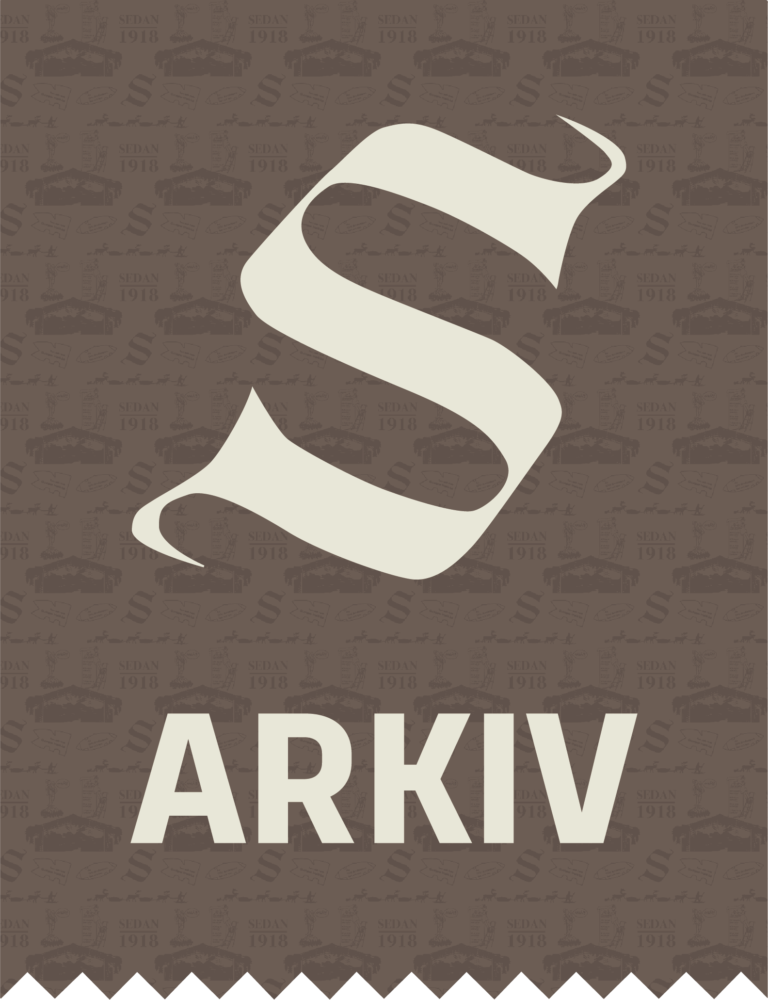
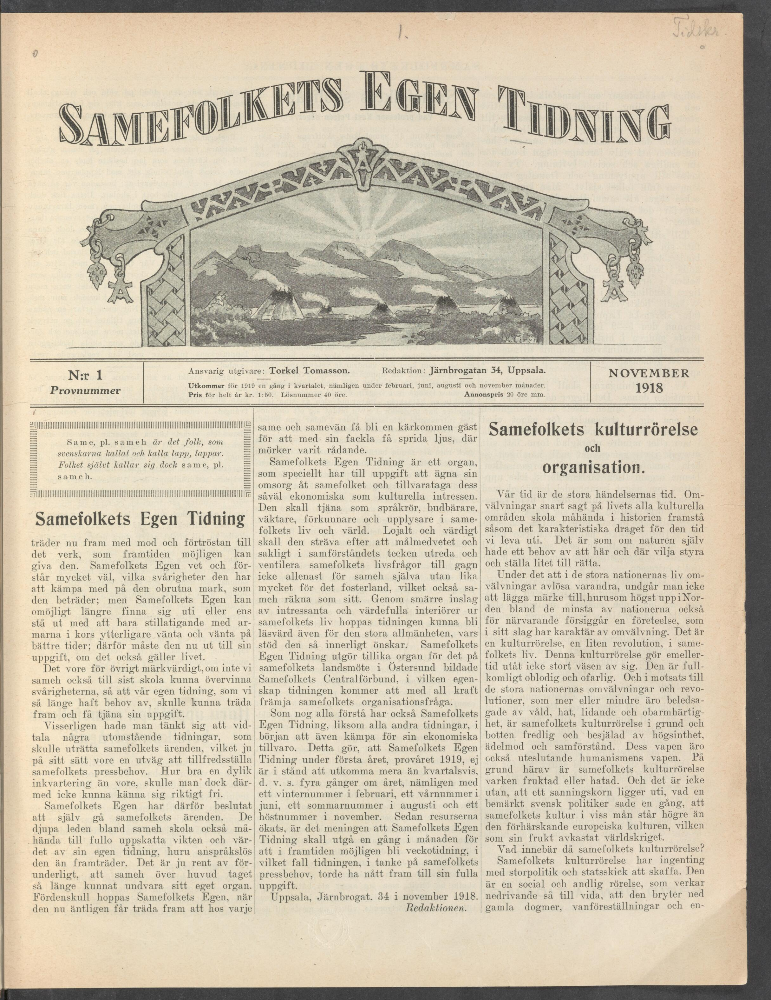

# Utforska Samefolkets arkiv

Bures! Hej! 👋

Mu namma lea Johannes Widegren. Jag heter Johannes Widegren. 🧔🏼‍♀️

Jag är doktorand i biblioteks- och informationsvetenskap vid Linneuniversitetet i Växjö. 🎓

Mitt [avhandlingsprojekt](https://www.lnu.se/forskning/forskningsprojekt/doktorandprojekt-manniskocentrerad-artificiell-intelligens-for-forbattrad-tillganglighet-och-sokbarhet-i-samiska-arkivsamlingar/) är ett samarbete med tidningen [Samefolket](https://samefolket.se/) där vi tillsammans undersöker möjligheter att göra deras arkiv mer sökbart med hjälp av AI. 🤖

"Men arkivet digitaliserades ju 2025 – det går ju redan att söka i på [samefolket.se](https://digital.samefolket.se/)?" 🤷

Jovisst! Men för att få en träff måste du söka på exakt de ord som står i tidningen – söker du på "ren" 🦌 får du inga träffar på "sarv" eller "vaja", men däremot på "ren" som i "inte smutsig". 🧼

1985 publicerades _Index till Samefolkets Egen Tidning – Samefolket 1818–1973_ av Israel och Maja Ruong. De läste igenom varenda artikel i tidningen och samlade alla artiklar som handlar om ett särskilt ämne under en och samma uppslagsrubrik, t.ex. _Renen_ som innefattar artiklar om både sarvar och vajor. Sök på "renen" i grafen nedan för att se hur många artiklar som taggats med den rubriken per år. Lägg gärna till något annat att jämföra med, som "vildrenen".

<noscript></noscript>

"Okej, intressant! Men, det gavs ju ut många fler nummer på 1960-talet än på 1920-talet, så alla kurvor går ju upp i slutet – hur ska jag veta vilka år ämnet varit störst?" 🤔

Helt sant! Om vi tittar på hur många _sidor_ Samefolket gett ut per år ser kurvan ut så här, med många fler nummer och artiklar från 1960 och framåt:

<noscript></noscript>

För att kompensera för ökningen i artiklar per år visar grafen nedan _andelar_ istället – hur stor andel artiklar som taggats med t.ex. "Renen" av alla artiklar det året – typ "0,02", dvs. 2 %.

<noscript></noscript>

"Härligt! Då ser man ju hur ämnen kommer och går över tid. Men artiklarna efter 1973 då?" 😳

Där satte du fingret på spiken! 🔨 I projektet _Svensk Samisk Bibliografi_ under åren 2000-2003 indexerades fler av Samefolkets artiklar av samiska bibliotekarier. Men det finns fortfarande stora luckor med årgångar som inte blivit indexerade, se grafen nedan.

<noscript></noscript>

Det är här AI kommer in. Eller _automatiserad ämnesordsindexering_ närmare bestämt. Om vi kan träna en AI-modell på ämnesorden från _Svensk Samisk Bibliografi_-projektet skulle den kunna hjälpa samiska bibliotekarier att indexera resten av arkivet snabbare och till lägre kostnad. 

Men kommer det att fungera ❓ Det är det vi ska ta reda på.

Tack för att du besökt min sajt! Ollu giitu! 😁

## Bonus:
### Språk i Samefolket
Så här är artiklarna som indexerats i Libris fördelade efter huvudsakligt språk i artikeln!

<noscript></noscript>

### Samefolket in translation

The following is a translation of the first article of the trial issue published by _Samefolket_ in November 1918. Translation draft by Gemma3:12b, corrected by me.

> _"The Sámi People’s Own Newspaper now steps forward with courage and confidence in the work that the future may give it. The Sámi People’s Own knows and understands very well the difficulties it faces in entering uncharted territory; but The Sámi People’s Own can no longer tolerate or even endure simply standing still with its arms crossed, waiting and waiting for better times; therefore, it must now go forth to its task, even if it concerns life itself._

> _It would be remarkable, of course, if we Sámi were not, in the end, to overcome the difficulties so that our own newspaper, which we have long needed, could emerge and fulfill its purpose._

> _Certainly, there was consideration given to appealing to external newspapers to handle the Sámi people’s affairs, which would, in its way, be a way to satisfy the Sámi people’s press needs. However good such an arrangement might be, it would not allow one to feel truly free._

> _The Sámi People’s Own has therefore decided to handle the Sámi people’s affairs itself. The deepest circles among the Sámi may also perhaps fully appreciate the importance and value of their own newspaper, however modest it may appear. It is quite astonishing that the Sámi have, in general, been able to do without their own newspaper for so long. Therefore, The Sámi People’s Own hopes, as it finally emerges, to become a welcome guest for every Sámi and Sámi friend, so that with its torch it can spread light where darkness has prevailed._

> _The Sámi People’s Own Newspaper has the special task of dedicating its care to the Sámi people and safeguarding both their economic and cultural interests. It will serve as a spokesperson, messenger, guardian, herald, and educator in the Sámi people’s life and world. Loyal and dignified, it will strive purposefully and objectively, in the spirit of cooperation, to investigate and ventilate the Sámi people’s life questions to the benefit not only of the Sámi themselves but also of the homeland which the Sámi also consider their own. Through smaller inclusions of interesting and valuable interiors from Sámi life, the newspaper hopes to become readable even for the general public, whose support it earnestly desires. The Sámi People’s Own Newspaper is also an instrument of the Sámi People’s Central Association, formed at the Sámi people’s national meeting in Östersund, and in this capacity the newspaper will promote the Sámi people’s organizational issues with all its might._

> _As probably everyone understands, The Sámi People’s Own Newspaper, like all other newspapers, must also initially struggle for its economic existence. This means that The Sámi People’s Own Newspaper is not able to be published more than quarterly during the first year, the trial year of 1919, namely with a winter issue in February, a spring issue in June, a summer issue in August, and an autumn issue in November. Once resources have increased, the intention is for The Sámi People’s Own Newspaper to be published once a month, and in the future possibly become a weekly newspaper, in which case the newspaper, considering the Sámi people’s press needs, would likely have reached its full purpose._

> _Uppsala, Järnbrogat. 34 in November 1918._

> _The Editorial Staff."_

